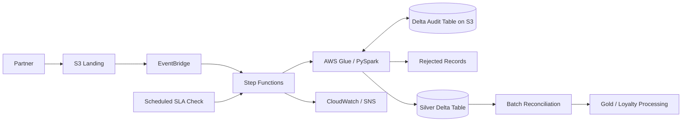

# Pipeline & Integration Design

**Objective:** Process 20 million daily partner transactions and make reconciled data available for loyalty processing by 06:00.

## Architecture

## Design decisions

| Requirement | Proposed approach |
|---|---|
| Ingestion mechanism | Daily batch ingestion into S3 via secure SFTP or direct upload. Retain original files for audit and recovery. |
| File detection / orchestration | A partner manifest arrival triggers EventBridge and Step Functions; scheduled checks detect missing files. A Delta audit table on S3 records file identity, batch, status, timestamps and reconciliation metrics. Process through a single active writer workflow to avoid competing writes. |
| Schema evolution | Maintain versioned schemas in configuration. Allow approved compatible additions; quarantine incompatible changes and notify the data owner. |
| Duplicate detection | Deduplicate using the transaction business key and latest source version. Use conditional Delta MERGE across batches; flag conflicting records with the same version. |
| Data contracts | Agree on schema, required fields, business key, timestamp conventions, version ordering, delivery deadline and manifest format with the partner. |
| Reprocessing | Replay retained source files by file or batch ID using the same idempotent transformation and controlled audit updates. |
| Failure recovery | Retry transient errors with backoff. Record persistent failures and retain inputs. Serialize target and audit writes; replay incomplete runs using idempotent MERGE operations. Audit and target commits are separate, so verify reconciliation before publishing. |
| SLA monitoring | Track expected arrivals, processing duration and batch readiness. Use scheduled checks to detect missing files and SLA risk before 06:00. |
| Reconciliation | Compare manifest file and row counts against actual inputs. Reconcile valid, rejected and duplicate rows, and MERGE insert/update/ignore counts. Check financial totals by currency. |
| CI/CD | Use Git and Azure DevOps to run automated tests and deploy versioned code, configuration and Terraform infrastructure through development, test and production. |
| Alerting | Use CloudWatch and SNS to notify support of failed jobs, schema changes, abnormal rejection rates, missing files and SLA risks. |

## Batch completeness and scale

A partner manifest defines the expected files and record counts. Process available files and retry missing files through the same controlled workflow. Release the batch only after completeness and quality checks pass. Escalate incomplete batches rather than silently publishing them. Use distributed Glue processing and appropriately sized files, and benchmark Delta MERGE and maintenance operations.

## Assumptions

The existing local PySpark pipeline is the transformation proof of concept; the AWS components are proposed, not deployed. A single active writer is assumed; the Delta audit table is not a distributed lock. Partner delivery cutoffs, quality thresholds and Glue capacity must be agreed and validated through representative load testing before the 06:00 SLA can be guaranteed.
